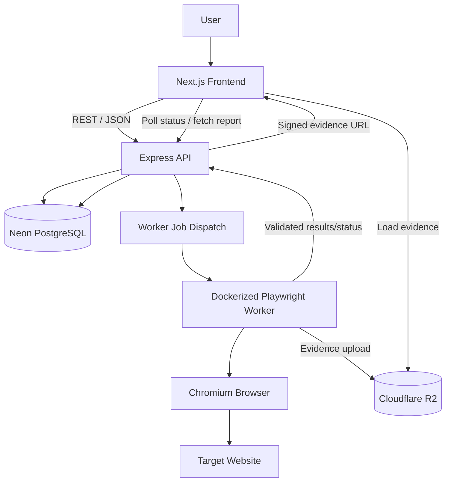
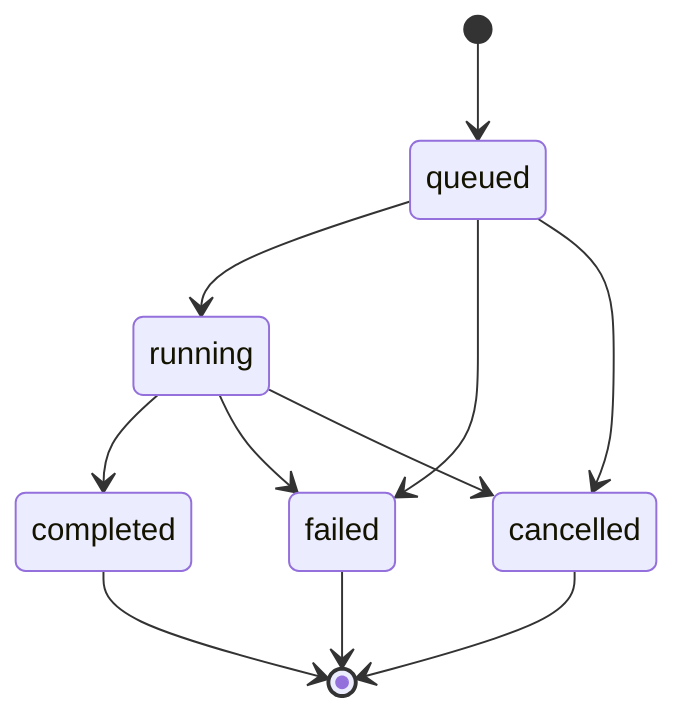

# FlowLens — System Architecture

## 1. High-level architecture

## 2. Component responsibilities

### Frontend
- Collect URL and scan options.
- Submit scan creation request.
- Display scan status and progress.
- Fetch and render report, findings and evidence.
- Never connect directly to PostgreSQL or use R2 secret keys.

### Backend API
- Validate requests and enforce security rules.
- Create scan records.
- Dispatch and track jobs.
- Validate worker callbacks/results.
- Persist structured data.
- Generate short-lived evidence URLs.
- Expose scan history and reports.

### Dockerized worker
- Run browser automation in an isolated container.
- Launch Chromium through Playwright.
- Navigate within configured limits.
- Capture screenshots and interaction evidence.
- Evaluate observations against the configured assignment rubric.
- Upload artifacts to R2.
- Return normalized results and status.

### PostgreSQL
- Store structured scan and report data.
- Enforce relationships and data integrity.
- Support scan history and report retrieval.

### Cloudflare R2
- Store screenshots, recordings and generated artifacts.
- Keep large binary content out of PostgreSQL.

## 3. Worker communication

For the assignment MVP, choose one explicit job-dispatch strategy and document it in code.

Recommended simple strategy for a single Codespace:
- Backend starts a worker container through Docker Compose or sends a job to a dedicated worker process.
- Worker receives a bounded job payload through a private internal mechanism.
- Worker reports progress and completion to a private backend endpoint or writes results through a controlled repository/service layer.

Do not expose an unauthenticated worker callback publicly. Use a private network and a secret/token for internal callbacks. Avoid mounting the Docker socket into an untrusted container. If the backend controls Docker directly, understand that Docker socket access is effectively host-level control.

For a more scalable production design, introduce a durable queue (for example, Redis/BullMQ or a managed queue). This is optional unless required by the assignment; do not add infrastructure without a need.

## 4. Scan state machine

Terminal states are `completed`, `failed` and `cancelled`. A completed scan must have a persisted result. A failed scan should include a safe error code and message.

## 5. Security boundary

The target website is untrusted. The worker must:
- Block loopback, private, link-local and cloud metadata IP ranges.
- Validate every redirect destination.
- Defend against DNS rebinding by checking resolved addresses at connection time where feasible.
- Limit page count, depth, runtime, download size and concurrency.
- Avoid downloading or executing arbitrary files.
- Run as a non-root user where practical.
- Use a read-only filesystem where feasible and a temporary writable directory for captures.
- Avoid privileged Docker mode.
- Keep secrets out of page context and browser logs.

## 6. Deployment/development topology

During development:
- Next.js and Express run directly in the Codespace terminal.
- The Playwright worker runs in Docker.
- Neon and R2 are external managed services.
- Codespaces port forwarding exposes only the UI/API ports needed for development.

Codespaces is a development environment, not an always-on production host. A production deployment should use suitable hosting for the frontend/API and a container-capable worker runtime.

## 7. Design decisions

- Use asynchronous scan creation to avoid long HTTP requests.
- Use PostgreSQL for durable state.
- Use R2 for binary artifacts.
- Keep worker execution isolated in Docker.
- Keep the seven-category rubric in versioned configuration.
- Prefer simple polling for the MVP; add WebSockets/SSE only if required.
