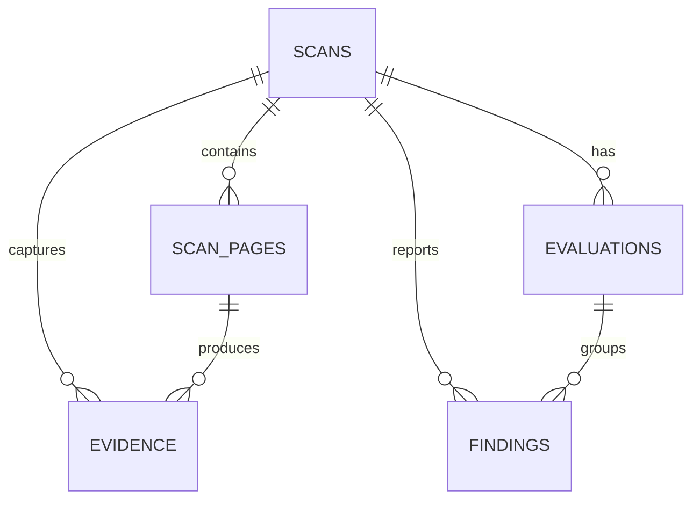

# FlowLens — PostgreSQL Schema

This is a proposed baseline schema. Adjust field names and category definitions to the final PRD and implementation. Use UUIDs for identifiers and UTC timestamps (`timestamptz`).

## 1. Entity relationships



## 2. SQL migration

```sql
CREATE EXTENSION IF NOT EXISTS pgcrypto;

CREATE TABLE scans (
  id UUID PRIMARY KEY DEFAULT gen_random_uuid(),
  target_url TEXT NOT NULL,
  normalized_url TEXT NOT NULL,
  status TEXT NOT NULL CHECK (
    status IN ('queued', 'running', 'completed', 'failed', 'cancelled')
  ),
  options JSONB NOT NULL DEFAULT '{}'::jsonb,
  overall_score NUMERIC(5,2),
  error_code TEXT,
  error_message TEXT,
  created_at TIMESTAMPTZ NOT NULL DEFAULT NOW(),
  started_at TIMESTAMPTZ,
  completed_at TIMESTAMPTZ,
  updated_at TIMESTAMPTZ NOT NULL DEFAULT NOW()
);

CREATE INDEX scans_created_at_idx ON scans (created_at DESC);
CREATE INDEX scans_status_created_at_idx ON scans (status, created_at DESC);

CREATE TABLE scan_pages (
  id UUID PRIMARY KEY DEFAULT gen_random_uuid(),
  scan_id UUID NOT NULL REFERENCES scans(id) ON DELETE CASCADE,
  url TEXT NOT NULL,
  title TEXT,
  page_status INTEGER,
  depth INTEGER NOT NULL DEFAULT 0,
  visit_order INTEGER NOT NULL,
  load_time_ms INTEGER,
  console_errors JSONB NOT NULL DEFAULT '[]'::jsonb,
  created_at TIMESTAMPTZ NOT NULL DEFAULT NOW(),
  UNIQUE (scan_id, visit_order)
);

CREATE INDEX scan_pages_scan_id_idx ON scan_pages (scan_id);

CREATE TABLE evaluations (
  id UUID PRIMARY KEY DEFAULT gen_random_uuid(),
  scan_id UUID NOT NULL REFERENCES scans(id) ON DELETE CASCADE,
  category_key TEXT NOT NULL,
  category_name TEXT NOT NULL,
  score NUMERIC(5,2),
  score_scale TEXT,
  status TEXT NOT NULL,
  summary TEXT NOT NULL,
  rubric_version TEXT NOT NULL,
  details JSONB NOT NULL DEFAULT '{}'::jsonb,
  created_at TIMESTAMPTZ NOT NULL DEFAULT NOW(),
  UNIQUE (scan_id, category_key)
);

CREATE INDEX evaluations_scan_id_idx ON evaluations (scan_id);

CREATE TABLE findings (
  id UUID PRIMARY KEY DEFAULT gen_random_uuid(),
  scan_id UUID NOT NULL REFERENCES scans(id) ON DELETE CASCADE,
  evaluation_id UUID REFERENCES evaluations(id) ON DELETE SET NULL,
  severity TEXT NOT NULL CHECK (
    severity IN ('info', 'low', 'medium', 'high', 'critical')
  ),
  title TEXT NOT NULL,
  description TEXT NOT NULL,
  recommendation TEXT,
  confidence NUMERIC(4,3),
  created_at TIMESTAMPTZ NOT NULL DEFAULT NOW()
);

CREATE INDEX findings_scan_id_idx ON findings (scan_id);

CREATE TABLE evidence (
  id UUID PRIMARY KEY DEFAULT gen_random_uuid(),
  scan_id UUID NOT NULL REFERENCES scans(id) ON DELETE CASCADE,
  page_id UUID REFERENCES scan_pages(id) ON DELETE SET NULL,
  finding_id UUID REFERENCES findings(id) ON DELETE SET NULL,
  evidence_type TEXT NOT NULL CHECK (
    evidence_type IN ('screenshot', 'video', 'trace', 'log', 'other')
  ),
  object_key TEXT NOT NULL,
  content_type TEXT NOT NULL,
  byte_size BIGINT,
  page_url TEXT,
  description TEXT,
  captured_at TIMESTAMPTZ NOT NULL DEFAULT NOW(),
  metadata JSONB NOT NULL DEFAULT '{}'::jsonb
);

CREATE INDEX evidence_scan_id_idx ON evidence (scan_id);
CREATE INDEX evidence_page_id_idx ON evidence (page_id);
CREATE INDEX evidence_finding_id_idx ON evidence (finding_id);

CREATE TABLE scan_events (
  id BIGINT GENERATED ALWAYS AS IDENTITY PRIMARY KEY,
  scan_id UUID NOT NULL REFERENCES scans(id) ON DELETE CASCADE,
  event_type TEXT NOT NULL,
  message TEXT,
  metadata JSONB NOT NULL DEFAULT '{}'::jsonb,
  created_at TIMESTAMPTZ NOT NULL DEFAULT NOW()
);

CREATE INDEX scan_events_scan_id_created_at_idx
  ON scan_events (scan_id, created_at);
```

## 3. Data rules

- `category_key` must come from the assignment's exact seven-category rubric.
- `rubric_version` records which evaluation rules produced the score.
- `overall_score` must be computed according to the rubric, not by an arbitrary average unless the assignment defines that calculation.
- `object_key` identifies an R2 object; it is not a public URL.
- `error_message` must not contain secrets, stack traces or sensitive internal details.
- `updated_at` should be maintained by application logic or a database trigger.

## 4. Suggested TypeScript types

```ts
export type ScanStatus =
  | "queued"
  | "running"
  | "completed"
  | "failed"
  | "cancelled";

export interface ScanRecord {
  id: string;
  targetUrl: string;
  status: ScanStatus;
  createdAt: string;
  startedAt?: string | null;
  completedAt?: string | null;
}

export interface EvaluationRecord {
  id: string;
  scanId: string;
  categoryKey: string;
  categoryName: string;
  score: number | null;
  status: string;
  summary: string;
  rubricVersion: string;
}
```

## 5. Migration notes

- Put this SQL in a versioned migration file, for example `backend/migrations/001_initial_schema.sql`.
- Run it against a development Neon database first.
- Add further constraints only after confirming the assignment's scoring/status semantics.
- If using an ORM, keep the ORM model and SQL migration aligned.
