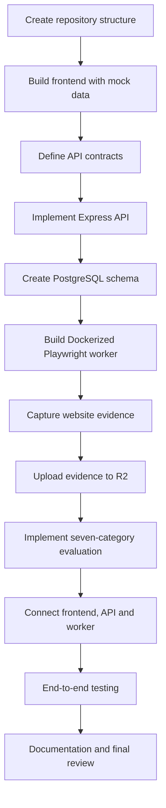

# FlowLens — Development and Application Workflow

## 1. Development workflow overview

The recommended approach is to build the UI and API first, then implement the Dockerized worker, and finally connect all components.



## 2. Phase 1 — Prepare GitHub repository

1. Create or open the FlowLens GitHub repository.
2. Create the folders described in `index.md`.
3. Add the documentation under `docs/`.
4. Add `.env.example`.
5. Add a `.gitignore` that excludes `.env`, `node_modules`, build output, Playwright artifacts and local logs.
6. Push the initial structure to GitHub.

## 3. Phase 2 — Create a Codespace

1. Open the FlowLens repository on GitHub.
2. Select **Code → Codespaces → Create codespace on main**.
3. Wait for the cloud workspace to initialize.
4. Open the integrated terminal.
5. Confirm the repository directory:

```bash
pwd
ls
```

6. Verify Docker availability:

```bash
docker --version
docker compose version
docker info
```

If `docker info` cannot connect to the daemon, stop and fix the Codespaces Docker environment before trying to build the worker. Do not install Docker Desktop on the local laptop for this workflow.

A Codespace is associated with a repository and selected branch. Reopen the existing Codespace when continuing work; do not create a new one for every session.

## 4. Phase 3 — Build frontend

Implement these screens:
- Dashboard
- New Scan
- Scan Progress
- Results
- Flow Viewer
- Scan History

Initially use typed mock data. Keep API calls behind a frontend API client so mock data can later be replaced without rewriting components.

Suggested development commands (adapt to the actual package scripts):

```bash
cd frontend
yarn install
yarn dev
```

## 5. Phase 4 — Build backend

Implement:
- Express app and server entry point.
- Request validation and centralized error middleware.
- Scan creation, status, history and result routes.
- Scan service and repository interfaces.
- Worker dispatch abstraction.

Start with a mock worker adapter so the frontend/API lifecycle can be tested before browser automation is ready.

```bash
cd backend
yarn install
yarn dev
```

## 6. Phase 5 — Configure Neon and R2

1. Create a Neon PostgreSQL project and database.
2. Create a Cloudflare R2 bucket.
3. Create least-privilege credentials for the bucket.
4. Add credentials to the Codespace environment or an untracked `.env` file.
5. Apply the SQL migration from `schema.md`.
6. Test database connection and R2 upload/download independently.

Never commit secrets.

## 7. Phase 6 — Build the Dockerized Playwright worker

1. Create the worker package and Dockerfile.
2. Pin the Playwright package version.
3. Use a Playwright container image whose tag matches the installed Playwright version.
4. Implement browser launch, navigation limits and screenshot capture.
5. Build the image:

```bash
docker compose build worker
```

6. Run the worker service:

```bash
docker compose up -d worker
```

7. Inspect running containers and logs:

```bash
docker ps
docker compose logs -f worker
```

The worker must run in a real Docker container. Running Playwright directly in the backend process does not satisfy the Dockerized-worker requirement.

## 8. Phase 7 — Integrate and execute a scan

1. Start the backend and frontend in separate Codespaces terminals.
2. Submit a public test URL through the UI.
3. Confirm the backend creates a `queued` scan row.
4. Confirm the worker receives the job and changes status to `running`.
5. Confirm Chromium navigates to the target.
6. Confirm screenshots/evidence are captured.
7. Confirm evidence is uploaded to R2.
8. Confirm category evaluations and findings are saved to PostgreSQL.
9. Confirm scan status becomes `completed`.
10. Refresh the report page and verify data is loaded from the API/database rather than mock state.

## 9. Running multiple processes in Codespaces

Use separate integrated terminals:

**Terminal A — Frontend**

```bash
cd frontend
yarn dev
```

**Terminal B — Backend**

```bash
cd backend
yarn dev
```

**Terminal C — Worker**

```bash
docker compose up -d worker
docker compose logs -f worker
```

The exact Compose service name and scripts must match the repository.

Use the Codespaces **Ports** tab to open the forwarded frontend port. Keep backend and internal worker ports private unless external access is specifically needed.

## 10. Git workflow

After a logical unit of work:

```bash
git status
git add .
git commit -m "Describe the completed change"
git push origin main
```

Prefer feature branches and pull requests if multiple people are collaborating. Do not commit `.env`, credentials, generated browser profiles or large temporary artifacts.

## 11. Resource and Codespaces cost control

- Start with a smaller machine type and increase only if the worker needs more memory/CPU.
- Set an appropriate idle timeout.
- Stop the Codespace when finished.
- Remove unused Docker images/build cache when disk usage becomes high:

```bash
docker system df
docker image prune
docker builder prune
```

Use `docker volume prune` only after confirming that no required data is stored in Docker volumes. Codespaces allowance and billing depend on the account's current plan and usage settings; check GitHub billing before long-running sessions.

## 12. Final acceptance test

- [ ] Frontend builds and loads.
- [ ] URL validation works on client and server.
- [ ] Scan creation returns a scan ID.
- [ ] Scan record is persisted.
- [ ] Docker worker container starts successfully.
- [ ] Playwright launches Chromium inside the container.
- [ ] Target website is inspected within configured limits.
- [ ] Actual screenshots/evidence are captured.
- [ ] Evidence is uploaded to R2.
- [ ] Seven assignment-defined categories are evaluated.
- [ ] Findings reference evidence where applicable.
- [ ] Results are persisted in PostgreSQL.
- [ ] Scan status reaches a terminal state.
- [ ] Results survive page refresh.
- [ ] Failure cases are visible and diagnosable.
- [ ] No secrets are committed.
- [ ] README contains setup and execution instructions.
